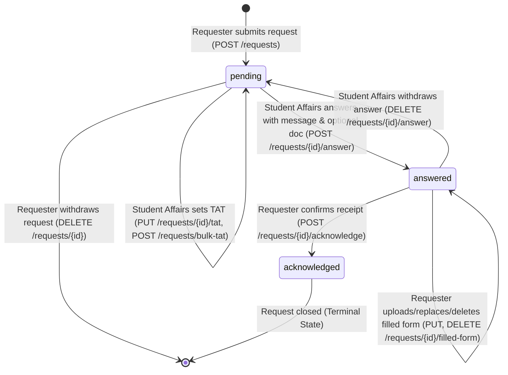

# Official DocDesk API Specification — Section 6 Implementation Reference

> **Authoritative Specification:** Based on CampusOS API Cookbook, Section 6: "DocDesk: Document requests" (pages 18–22).
> **Base API Path:** `/api/v1/docdesk`
> **Backend Integration Status:** Fully compliant and verified against both mock test suites and the live hosted OpenAPI schema (`https://campus-os-backend-8sjf.onrender.com/openapi.json`).

---

## 1. System Overview & Participant Roles

DocDesk governs the institutional lifecycle of academic and administrative document requests. The module recognises three distinct participant profiles:

1. **Requester** (`student`, `faculty`, or non-Student Affairs `office_staff`):
   - Can raise document requests (`POST /requests`) by choosing an active document type and entering a justification.
   - Can view and manage their own requests (`GET /requests?mine=true` or default scoped filter).
   - Can edit request details or withdraw pending requests (`PATCH /requests/{id}`, `DELETE /requests/{id}`).
   - Once answered by Student Affairs, can download the attached official document (`GET /requests/{id}/document`).
   - If required by Student Affairs, can complete the workflow round-trip by uploading, downloading, or removing a filled-in form (`PUT /requests/{id}/filled-form`, `GET /requests/{id}/filled-form`, `DELETE /requests/{id}/filled-form`).
   - Can acknowledge receipt to formally close the request (`POST /requests/{id}/acknowledge`).

2. **Student Affairs** (`office_staff` with `dept = "Student Affairs"`):
   - Department matching is case-insensitive, ignores trailing `"Dept"` / `"Department"` (e.g., `"Student Affairs"`, `"student affairs"`, `"Student Affairs Dept"`).
   - Processes requests across the entire institution.
   - Sets single turnaround time targets (`PUT /requests/{id}/tat`) and bulk turnaround times (`POST /requests/bulk-tat`) for pending requests.
   - Provides official answers (`POST /requests/{id}/answer`) with mandatory message and optional attached document (PDF/Word).
   - Can edit or update answers (`PATCH /requests/{id}/answer`), replace/remove documents, or withdraw answers entirely (`DELETE /requests/{id}/answer`), reverting requests to `pending`.
   - Manages institutional document types (`GET`, `POST`, `PATCH`, `DELETE /doc-types`).

3. **Admin** (`role = "admin"`):
   - Possesses institution-wide **read-only** audit visibility over all requests and document types.
   - Can view all request lists and individual request details (`GET /requests`, `GET /requests/{id}`).
   - Can download answer documents and filled-in forms for compliance audits (`GET /requests/{id}/document`, `GET /requests/{id}/filled-form`).
   - **Strict Read-Only Constraint:** Any mutation attempt (`POST`, `PATCH`, `PUT`, `DELETE`) by an admin in DocDesk returns `403 FORBIDDEN`.

---

## 2. Request Lifecycle & State Machine

DocDesk enforces exactly three canonical lifecycle statuses:



- **`pending`**: Initial state upon submission. Student Affairs reviews the request and may set an expected turnaround date (TAT). The requester can edit the type or reason, or withdraw the request.
- **`answered`**: Student Affairs has submitted an official answer text (1–2000 characters) and optionally attached a file. The answer does *not* necessarily indicate approval (it can explain missing requirements or supply a form to complete). The requester can view the answer, download attachments, and upload a filled form. Student Affairs can withdraw the answer, returning the request to `pending`.
- **`acknowledged`**: The requester confirms receipt of the document or answer. The request is closed. No further modifications, answers, or form uploads are permitted.

---

## 3. Core APIs Specification

All endpoints are relative to `/api/v1/docdesk`.

### A. Request a Document

- **Endpoint:** `POST /requests`
- **Who:** Student, Faculty, Office Staff
- **Content-Type:** `application/json`
- **Request Body:**
  ```json
  {
    "doc_type_id": "DTY-...",
    "reason": "Needed for external scholarship application"
  }
  ```
- **Validation Rules:**
  - `doc_type_id`: Valid, active document type ID from `GET /doc-types`.
  - `reason`: Required string, 5–1000 characters. Leading and trailing whitespace trimmed.
- **Response:** `201 Created`
  ```json
  {
    "request_id": "DRQ-...",
    "doc_type_id": "DTY-...",
    "doc_type_name": "Bonafide Certificate",
    "reason": "Needed for external scholarship application",
    "status": "pending",
    "requester_id": "USR-...",
    "requester_name": "Asha Sharma",
    "requester_role": "student",
    "requester_dept": "Computer Science",
    "expected_by": null,
    "tat_note": null,
    "created_at": "2026-10-31T05:00:00Z",
    "updated_at": "2026-10-31T05:00:00Z"
  }
  ```
- **Error Responses:**
  - `400 VALIDATION_ERROR`: `reason` < 5 characters or > 1000 characters.
  - `409 DOC_TYPE_ARCHIVED`: Document type is archived; new requests cannot be created for it.
  - `401 UNAUTHORIZED`: Missing or invalid Bearer authentication token.

---

### B. Track, List, Edit, and Withdraw Requests

#### 1. List Requests
- **Endpoint:** `GET /requests`
- **Who:** Everyone (Scoped automatically by backend)
- **Query Parameters:**
  - `status`: Optional filter (`pending`, `answered`, `acknowledged`).
  - `doc_type_id`: Optional filter by document type ID (`DTY-...`).
  - `mine`: Optional boolean (`true` or `false`). Allows Student Affairs to view only requests they personally raised as a requester.
  - `limit`: Optional integer pagination limit (1–100, default `25`).
  - `cursor`: Optional opaque string cursor for cursor-based pagination.
- **Access Scope:**
  - Student Affairs and Admin see all institutional requests by default.
  - Students and Faculty see only their own requests regardless of `mine` flag.
- **Response:** `200 OK`
  ```json
  {
    "count": 1,
    "items": [
      {
        "request_id": "DRQ-...",
        "doc_type_id": "DTY-...",
        "doc_type_name": "Bonafide Certificate",
        "reason": "Needed for scholarship",
        "status": "pending",
        "requester_id": "USR-...",
        "requester_name": "Asha Sharma",
        "requester_role": "student",
        "created_at": "2026-10-31T05:00:00Z",
        "updated_at": "2026-10-31T05:00:00Z"
      }
    ],
    "next_cursor": null
  }
  ```

#### 2. Get Request Details
- **Endpoint:** `GET /requests/{request_id}`
- **Who:** Requester (own request), Student Affairs (all), Admin (all)
- **Response:** `200 OK` (Full request model with answer, documents, and form details).
- **Error Responses:**
  - `404 NOT_FOUND`: Request ID does not exist.
  - `403 FORBIDDEN`: Non-privileged user attempting to access another user's request.

#### 3. Edit Request
- **Endpoint:** `PATCH /requests/{request_id}`
- **Who:** Requester (own request only, while status is `pending`)
- **Content-Type:** `application/json`
- **Request Body:**
  ```json
  {
    "doc_type_id": "DTY-...",
    "reason": "Updated reason with at least 5 characters"
  }
  ```
  *(Both fields optional; at least one must be provided).*
- **Validation Rules:**
  - Only allowed while `status === 'pending'`.
  - `reason`: 5–1000 characters if supplied.
  - `doc_type_id`: Must reference an active document type.
- **Response:** `200 OK` with updated `DocRequest`.
- **Error Responses:**
  - `409 REQUEST_NOT_PENDING`: Request has already been answered or acknowledged.
  - `409 DOC_TYPE_ARCHIVED`: Provided document type is archived.
  - `403 FORBIDDEN`: User does not own the request.

#### 4. Withdraw Request
- **Endpoint:** `DELETE /requests/{request_id}`
- **Who:** Requester (own request only, while status is `pending`)
- **Response:** `200 OK` or `204 No Content`
- **Error Responses:**
  - `409 REQUEST_NOT_PENDING`: Request cannot be withdrawn once answered.
  - `403 FORBIDDEN`: User does not own the request.

---

### C. Answer a Request

#### 1. Add Initial Answer
- **Endpoint:** `POST /requests/{request_id}/answer`
- **Who:** Student Affairs (`role = 'office_staff'`, `dept = 'Student Affairs'`)
- **Content-Type:** `multipart/form-data`
- **Form Fields:**
  - `message`: Required string, 1–2000 characters.
  - `document`: Optional binary file (PDF or Word `.docx`, max 10 MB).
- **Behavior:** Request status transitions from `pending` to `answered`.
- **Response:** `201 Created` with updated `DocRequest`.
- **Error Responses:**
  - `400 VALIDATION_ERROR`: Empty message or invalid character length.
  - `409 REQUEST_NOT_PENDING` / `409 ALREADY_ANSWERED`: Request is not in `pending` state.
  - `413 FILE_TOO_LARGE`: Attached file exceeds 10 MB.
  - `415 UNSUPPORTED_MEDIA_TYPE`: Attached file is not PDF or DOCX.
  - `403 FORBIDDEN`: User is not Student Affairs staff.

#### 2. Edit Answer
- **Endpoint:** `PATCH /requests/{request_id}/answer`
- **Who:** Student Affairs
- **Content-Type:** `multipart/form-data`
- **Form Fields:**
  - `message`: Optional updated string (1–2000 characters).
  - `document`: Optional replacement binary file (PDF or Word `.docx`, max 10 MB).
  - `remove_document`: Optional string (`"true"`). If set to `"true"`, removes the existing attached document and any associated filled-in form.
- **Allowed:** Allowed while status is `answered` (until requester acknowledges).
- **Response:** `200 OK` with updated `DocRequest`.
- **Error Responses:**
  - `409 NOT_ANSWERED`: Request has not yet been answered.
  - `409 ALREADY_ACKNOWLEDGED`: Request is already acknowledged and locked.

#### 3. Withdraw Answer
- **Endpoint:** `DELETE /requests/{request_id}/answer`
- **Who:** Student Affairs
- **Behavior:** Reverts request status from `answered` back to `pending`. Purges the answer message, attached answer document, and any uploaded filled-in form.
- **Response:** `200 OK` or `204 No Content`.
- **Error Responses:**
  - `409 NOT_ANSWERED`: Request is not in `answered` status.
  - `409 ALREADY_ACKNOWLEDGED`: Request has already been acknowledged and cannot be reopened.

---

### D. Acknowledge a Request

- **Endpoint:** `POST /requests/{request_id}/acknowledge`
- **Who:** Requester (Owner)
- **Body:** None (empty body)
- **Behavior:** Transitions status from `answered` to `acknowledged`. Permanently closes the request.
- **Response:** `200 OK` with updated `DocRequest` (`status: "acknowledged"`).
- **Error Responses:**
  - `409 NOT_ANSWERED`: Request must be answered before it can be acknowledged.
  - `409 ALREADY_ACKNOWLEDGED`: Request is already acknowledged.
  - `403 FORBIDDEN`: User is not the owner of the request.

---

## 4. ⭐ Bonus APIs Specification

### E. Fetch Document Types

#### 1. List Document Types
- **Endpoint:** `GET /doc-types`
- **Who:** Everyone
- **Query Parameters:**
  - `status`: Optional filter (`active` [default] or `archived`).
  - `limit`: Optional pagination limit (default `100`).
  - `cursor`: Optional pagination cursor.
- **Response:** `200 OK`
  ```json
  {
    "count": 2,
    "items": [
      {
        "doc_type_id": "DTY-BONAFIDE",
        "name": "Bonafide Certificate",
        "description": "Proof of active student enrollment",
        "status": "active",
        "created_at": "2026-10-01T00:00:00Z",
        "updated_at": "2026-10-01T00:00:00Z"
      }
    ],
    "next_cursor": null
  }
  ```

#### 2. Get Single Document Type
- **Endpoint:** `GET /doc-types/{doc_type_id}`
- **Who:** Everyone
- **Response:** `200 OK` with `DocType`.

---

### F. Manage Document Types

Only Student Affairs office staff can manage the catalog of document types.

#### 1. Create Document Type
- **Endpoint:** `POST /doc-types`
- **Who:** Student Affairs
- **Content-Type:** `application/json`
- **Request Body:**
  ```json
  {
    "name": "Transcript Request Form",
    "description": "Official transcript for higher studies applications"
  }
  ```
- **Validation Rules:**
  - `name`: Required, 3–80 characters, unique across all document types.
  - `description`: Optional text.
  - Initial status is automatically set to `"active"`.
- **Response:** `201 Created` with created `DocType`.
- **Error Responses:**
  - `409 ALREADY_EXISTS`: A document type with this name already exists.
  - `422 VALIDATION_ERROR`: Name < 3 or > 80 characters.
  - `403 FORBIDDEN`: Non-Student Affairs user attempting modification.

#### 2. Update Document Type
- **Endpoint:** `PATCH /doc-types/{doc_type_id}`
- **Who:** Student Affairs
- **Content-Type:** `application/json`
- **Request Body:**
  ```json
  {
    "name": "Updated Name",
    "description": "Updated Description",
    "status": "archived"
  }
  ```
- **Status Values:**
  - `"archived"`: Prevents new requests from selecting this type. Existing requests retain it.
  - `"active"`: Makes the type available again for new requests.
- **Response:** `200 OK` with updated `DocType`.
- **Error Responses:**
  - `404 NOT_FOUND`: Document type does not exist.
  - `409 ALREADY_EXISTS`: If new name collides with another type.

#### 3. Delete Document Type
- **Endpoint:** `DELETE /doc-types/{doc_type_id}`
- **Who:** Student Affairs
- **Response:** `200 OK` or `204 No Content`.
- **Error Responses:**
  - `404 NOT_FOUND`: Document type does not exist.
  - `403 FORBIDDEN`: Non-Student Affairs caller.

---

### G. Set Turnaround Time (TAT)

Turnaround Time informs requesters when their document is expected to be fulfilled. TAT can only be set or modified while a request is in `pending` status.

#### 1. Single Request Turnaround Time
- **Endpoint:** `PUT /requests/{request_id}/tat`
- **Who:** Student Affairs
- **Content-Type:** `application/json`
- **Request Body:**
  ```json
  {
    "expected_by": "2026-11-05",
    "note": "Awaiting Principal signature and official seal"
  }
  ```
- **Validation Rules:**
  - `expected_by`: Required date string formatted as `YYYY-MM-DD`.
  - Date must be greater than or equal to today's date in Indian Standard Time (IST).
  - `note`: Optional operational note.
- **Response:** `200 OK` with updated `DocRequest`.
- **Error Responses:**
  - `409 REQUEST_NOT_PENDING`: Request is not pending.
  - `422 VALIDATION_ERROR`: Date in the past or invalid format.

#### 2. Bulk Turnaround Time
- **Endpoint:** `POST /requests/bulk-tat`
- **Who:** Student Affairs
- **Content-Type:** `application/json`
- **Request Body:**
  ```json
  {
    "request_ids": [
      "DRQ-2026-001",
      "DRQ-2026-002"
    ],
    "expected_by": "2026-11-05",
    "note": "Batch processed for signature"
  }
  ```
- **Validation Rules:**
  - `request_ids`: Array containing between 1 and 100 request IDs.
  - Duplicate IDs within the array are deduplicated.
  - **All-or-Nothing Atomic Execution:** If even one request does not exist or is no longer in `pending` status, the entire batch is rejected with no updates applied.
- **Response:** `200 OK`
  ```json
  {
    "count": 2,
    "items": [ ... ]
  }
  ```
- **Error Responses:**
  - `409 REQUEST_NOT_PENDING`: At least one request is not pending. The response details contain `details.request_ids` listing all non-pending IDs.
  - `404 NOT_FOUND`: One or more request IDs do not exist.

---

### H. Answer Document Transfer

Student Affairs can attach official generated documents to their answer.

- **Attach Document:** Provided as `document` multipart file in `POST /requests/{id}/answer` or `PATCH /requests/{id}/answer`.
- **Replace Document:** Upload new `document` multipart file in `PATCH /requests/{id}/answer`.
- **Remove Document:** Pass `remove_document=true` in `PATCH /requests/{id}/answer`. Note: Removing the answer document also removes any submitted filled-in form.
- **Download Document:**
  - **Endpoint:** `GET /requests/{request_id}/document`
  - **Who:** Requester (Owner), Student Affairs, Admin
  - **Response:** `200 OK` binary stream with `Content-Type: application/pdf` or `application/vnd.openxmlformats-officedocument.wordprocessingml.document` and standard `Content-Disposition` attachment header.
  - **File Restrictions:** PDF or Word (`.docx`), maximum size 10 MB.
  - **Error Responses:**
    - `404 NOT_FOUND` / `409 NO_DOCUMENT`: No document attached to this request.
    - `403 FORBIDDEN`: Non-owner attempting unauthorized download.

---

### I. Filled-Form Round Trip

This capability supports two-step workflows where Student Affairs provides an empty form (e.g. Scholarship Application Form) in their answer, and the requester fills and uploads it back.

1. **Upload / Replace Completed Form:**
   - **Endpoint:** `PUT /requests/{request_id}/filled-form`
   - **Who:** Requester (Owner)
   - **Content-Type:** `multipart/form-data`
   - **Form Field:** `file` (File binary). *Note: The live OpenAPI schema explicitly names this field `file`.*
   - **Allowed Formats:** PDF, Word (`.docx`), JPEG, PNG. Maximum size 10 MB.
   - **Allowed Status:** Must be `status === 'answered'`, an answer document must exist, and the request must not yet be `acknowledged`. Uploading again replaces the previous file.
   - **Response:** `200 OK` with updated `DocRequest`.
   - **Error Responses:**
     - `409 NOT_ANSWERED`: Request not yet answered.
     - `409 NO_DOCUMENT`: Answer did not attach a document to fill.
     - `409 ALREADY_ACKNOWLEDGED`: Request is acknowledged and closed.
     - `413 FILE_TOO_LARGE`: Exceeds 10 MB.
     - `415 UNSUPPORTED_MEDIA_TYPE`: Disallowed MIME type.

2. **Download Completed Form:**
   - **Endpoint:** `GET /requests/{request_id}/filled-form`
   - **Who:** Requester (Owner), Student Affairs, Admin
   - **Response:** `200 OK` binary stream with `Content-Disposition`.
   - **Error Responses:**
     - `404 NOT_FOUND`: No filled form uploaded.
     - `403 FORBIDDEN`: Unauthorized caller.

3. **Delete Completed Form:**
   - **Endpoint:** `DELETE /requests/{request_id}/filled-form`
   - **Who:** Requester (Owner)
   - **Allowed:** Allowed only while status is `answered` and before acknowledgment.
   - **Response:** `200 OK` or `204 No Content`.
   - **Error Responses:**
     - `409 ALREADY_ACKNOWLEDGED`: Request already acknowledged.
     - `404 NOT_FOUND`: No filled form to delete.

---

## 5. Screen-to-API Implementation Mapping

| Screen # | Reference Name | Route Path | Primary Components | API Endpoints Invoked | Access Roles |
|:---|:---|:---|:---|:---|:---|
| **Screen 1** | **My Requests** | `/tracks/docdesk/my-requests` | `MyRequestsScreen.tsx` | `GET /requests?status=&doc_type_id=&limit=&cursor=`, `GET /doc-types` | Student, Faculty, Staff (own) |
| **Screen 2** | **Request Form** | `/tracks/docdesk/new` | `RequestFormScreen.tsx` | `GET /doc-types?status=active`, `POST /requests` | Student, Faculty, Staff |
| **Screen 3** | **Pending Request Details** | `/tracks/docdesk/requests/:id` | `RequestDetailScreen.tsx`, `EditRequestModal.tsx` | `GET /requests/{id}`, `PATCH /requests/{id}`, `DELETE /requests/{id}`, `GET /doc-types` | Requester (Owner) |
| **Screen 4** | **Answered & Acknowledged Details** | `/tracks/docdesk/requests/:id` | `RequestDetailScreen.tsx`, `FilledFormPanel.tsx` | `GET /requests/{id}`, `GET /requests/{id}/document`, `PUT /requests/{id}/filled-form`, `GET /requests/{id}/filled-form`, `DELETE /requests/{id}/filled-form`, `POST /requests/{id}/acknowledge` | Requester (Owner) |
| **Screen 5** | **Staff Queue** | `/tracks/docdesk/staff` | `StaffQueueScreen.tsx` | `GET /requests?status=&doc_type_id=&mine=&limit=&cursor=`, `GET /doc-types`, `POST /requests/bulk-tat` | Student Affairs (`office_staff` + SA Dept) |
| **Screen 6** | **Staff Process Request** | `/tracks/docdesk/staff/requests/:id` | `StaffDetailScreen.tsx`, `SetTATModal.tsx`, `AnswerComposerModal.tsx` | `GET /requests/{id}`, `PUT /requests/{id}/tat`, `POST /requests/{id}/answer`, `PATCH /requests/{id}/answer`, `DELETE /requests/{id}/answer`, `GET /requests/{id}/document`, `GET /requests/{id}/filled-form` | Student Affairs |
| **Screen 7** | **Document Types Manager** | `/tracks/docdesk/staff/doc-types` | `DocTypeManagerScreen.tsx` | `GET /doc-types?status=active`, `GET /doc-types?status=archived`, `POST /doc-types`, `PATCH /doc-types/{id}`, `DELETE /doc-types/{id}` | Student Affairs |
| **Screen 8** | **Bulk TAT Screen** | `/tracks/docdesk/staff/bulk-tat` | `BulkTATScreen.tsx` | `GET /requests?status=pending`, `POST /requests/bulk-tat` | Student Affairs |
| *Hub* | **Requester Dashboard** | `/tracks/docdesk` | `RequesterDashboardScreen.tsx` | `GET /requests?limit=5`, `GET /doc-types` | Student, Faculty, Staff |
| *Hub* | **Document Catalogue** | `/tracks/docdesk/catalogue` | `DocumentCatalogueScreen.tsx` | `GET /doc-types?status=active` | Everyone |
| *Hub* | **Staff Operations Hub** | `/tracks/docdesk/staff/dashboard` | `StaffDashboardScreen.tsx` | `GET /requests?limit=100`, `GET /doc-types` | Student Affairs |
| *Admin* | **Admin Audit Overview** | `/tracks/docdesk/admin` | `AdminOverviewScreen.tsx` | `GET /requests?status=&doc_type_id=&limit=&cursor=`, `GET /doc-types` | Admin (Strict Read-Only) |
| *Admin* | **Admin Request Audit** | `/tracks/docdesk/admin/requests/:id` | `AdminDetailScreen.tsx` | `GET /requests/{id}`, `GET /requests/{id}/document`, `GET /requests/{id}/filled-form` | Admin (Strict Read-Only) |
